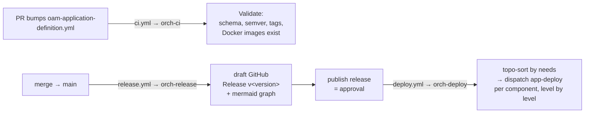

# ensemble-app-model

OAM application model for the **ensemble** application — the Gluon-style
`oam-application-definition.yml` declares a **release**: a version plus the
set of components (repo + version + dependencies) to deploy together.
The repo itself is a catalog component (`app-model` kind) of `ensemble`.

## `oam-application-definition.yml` schema

```yaml
kind: Application                 # OAM document kind
version: v2                       # OAM schema version
metadata:
  name: ensemble                  # application this model describes
  version: 1.2.0                  # semver — merge to main drafts release v1.2.0
environments:                     # optional — declared deploy targets
  - name: pro
    type: production
    infrastructures:              # infra targets nested under each env (OAM)
      - id: ensemble-api-pro
        type: vercel              # vercel | artifact-store | ...
        properties:               # free-form provider fields (OAM style)
          project: ensemble-api      # Vercel project name (literal, non-secret)
          credentialsId: VERCEL_TOKEN      # GitHub secret name in consumer
          orgId: VERCEL_ORG_ID           # GitHub variable name in consumer
          projectId: VERCEL_PROJECT_ID   # GitHub variable name in consumer
components:
  - name: ensemble-api
    repo: progmise/ensemble-api
    version: "0.1.0"              # git tag + Docker Hub image must exist
    rollback_version: "0.0.9"     # previous deployable version (optional)
    needs: []                     # deploy-after deps (component names)
    # deploy targets (ci_ids) live in the repo's .deploy/cd/{env}/cd.yml;
    # the orchestrator
                                  # dispatches one deploy per ci_id in the
                                  # target environment
trails:                           # ordered promotion paths
  - name: pre-pro-trails
    environments:
      - name: pre
        order: 1
      - name: pro
        order: 2
```

Validation rules (CI): semver `metadata.version`, unique env/component names and infra
ids, each `environments[].infrastructures[]` entry has `id` + `type`, `needs` ⊆
component names (acyclic), each `repo:version` exists, each component's deploy
targets (`.deploy/cd/{env}/cd.yml` or `infra:` override) non-empty and ⊆ infra ids. At deploy time the `environment` input must exist
in `environments` and every component must have at least one deploy target in
that env. Reference naming convention (OAM style): any `*Id` property names
a credential or identifier held in the *consumer repo's* GitHub secrets or
variables — values never live here.

## Flow



1. **PR** that bumps `metadata.version` and adjusts `components` → CI validates the
   manifest and renders the deploy plan.
2. **Merge to main** → a *draft* release `v<metadata.version>` is created.
3. **Publish the release** to approve it — done from the Ensemble
   dashboard (Releases → release → publish the `draft` tag), which calls the
   GitHub API server-side.
4. **Deploy** from the dashboard per environment (`pre`, `pro`). It dispatches
   `deploy.yml` with `version` + `environment` + `release_no` (`RLSE…`).
   Production deploys require a dashboard `release_no` — a bare manual
   dispatch of `pro` fails in `orch-deploy` Setup. Components deploy level by
   level following `needs`; each repo's `deploy.yml` (`app-deploy`) does the
   actual Vercel deploy, once per `ci_id` bound to that env.

## Setup

- Secret `ORCHESTRATOR_TOKEN`: PAT (fine-grained) with **Actions: write** on
  every repo listed in the definition — needed to dispatch their deploys.
- Var `DEPLOY_ENVIRONMENTS` (JSON, default `["pro"]`), `DOCKER_USERNAME`.
- Optional `GRAFANA_OTLP_ENDPOINT`/`GRAFANA_OTLP_AUTH` for tracing.

See `reusable-workflows/docs/orchestrator.md` for the design.
